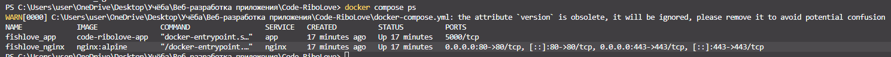
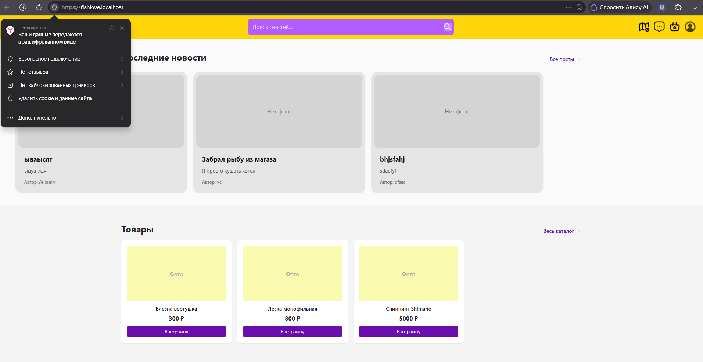
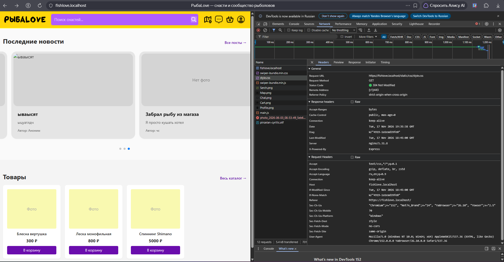
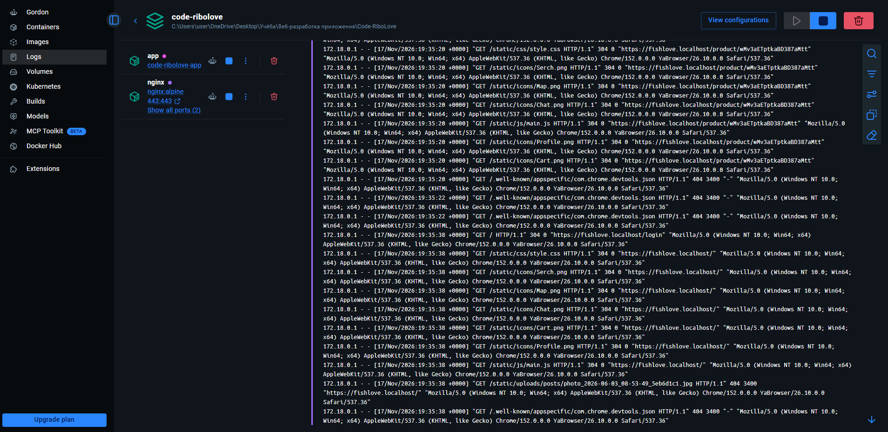
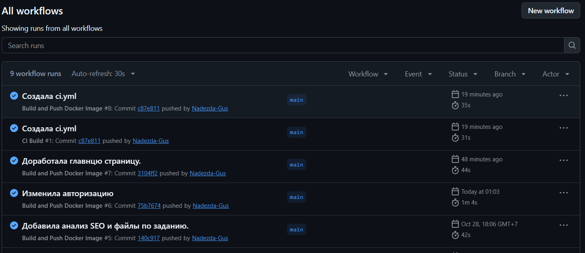

# Отчет по развертыванию проекта FishLove (Практическое занятие №18)

## 1. Схема архитектуры проекта
Архитектура проекта построена по схеме «Фуллстек-приложение на Node.js» с обратным прокси:
`Браузер (https) -> Nginx (порт 443) -> Node.js App (порт 5000) -> Firebase (облачная БД)`

## 2. Таблица сервисов
| Название сервиса | Технология | Внутренний порт | Продакшен-сервер |
| :--- | :--- | :--- | :--- |
| `app` | Node.js, Express | 5000 | `node src/server.js` |
| `nginx` | Nginx | 80, 443 | Nginx (alpine) |

## 3. Переменные окружения и секреты (только имена)
*   `SECRET_KEY` (секрет, ключ для cookie-session)
*   `FIREBASE_KEY_PATH` (путь к файлу ключа Firebase)
*   `NODE_ENV` (режим работы)
*   `PORT` (порт приложения)
*   `firebase_key.json` (файл сервисного аккаунта)
*   `*.pem`, `*.key` (SSL-сертификаты для Nginx)

## 4. Команды для запуска и остановки проекта
*   **Запуск (с пересборкой):** `docker compose up --build -d`
*   **Остановка:** `docker compose down`
*   **Просмотр логов:** `docker compose logs -f`

## 5. Скриншоты

### 5.1. Вывод команды `docker compose ps`

### 5.2. Страница проекта с замком HTTPS

### 5.3. Вкладка Network с запросом к API и заголовками

### 5.4. Список контейнеров в Docker Desktop

### 5.5. Успешное выполнение workflow GitHub Actions (Доп. задание)

## 6. Список ошибок и способы их устранения
1.  **Ошибка `Cannot find module './db'`** — неправильный путь при импорте. Исправлено заменой на `require("../db")`.
2.  **Ошибка `ReferenceError: getDb is not defined`** — отсутствовал импорт в файле `routes/auth.js`. Исправлено добавлением `const { getDb } = require("../db");`.
3.  **Пропадали фотографии при перезапуске Docker** — контейнеры эфемерны. Исправлено добавлением Volume в `docker-compose.yml` (`./public/uploads:/app/public/uploads`).
4.  **Ошибка `mkcert: Access is denied`** — попытка запуска из системной папки. Исправлено переходом в папку проекта (`cd`).
5.  **Ошибка 500 при регистрации** — не был задан `SECRET_KEY` в переменных окружения Docker. Исправлено передачей `-e SECRET_KEY=...` (или в `docker-compose.yml`).

## 7. Что нужно изменить для публикации на реальном сервере?
1.  **Домен и DNS**: Купить реальный домен (например, `fishlove.ru`) и настроить A-записи в DNS на IP сервера.
2.  **SSL**: Заменить локальные сертификаты `mkcert` на настоящие (например, выпущенные через Let's Encrypt с помощью Certbot).
3.  **База данных и 152-ФЗ**: Для соблюдения законодательства РФ перенести данные из Firebase (Google) на российский сервер (например, Yandex Cloud) с базой данных PostgreSQL или MongoDB.
4.  **Инфраструктура**: Арендовать VPS (Ubuntu), настроить файрвол (UFW) и закрыть все порты, кроме 80 и 443.
5.  **Безопасность**: Настроить реальные секреты (не хранить `.env` в репозитории, а использовать Secrets в панели хостинга или Docker Secrets).